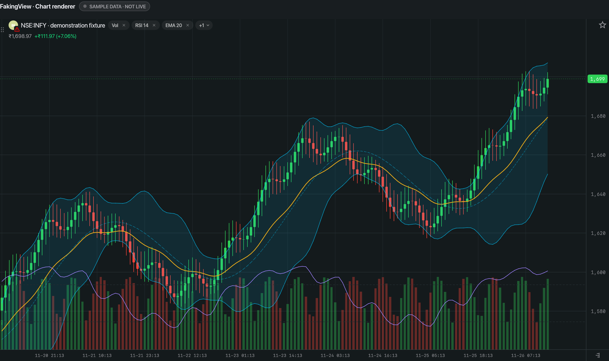
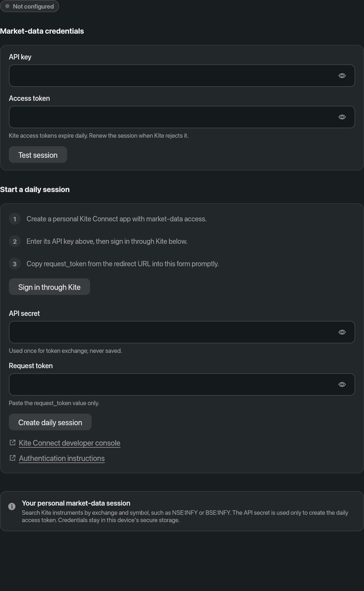
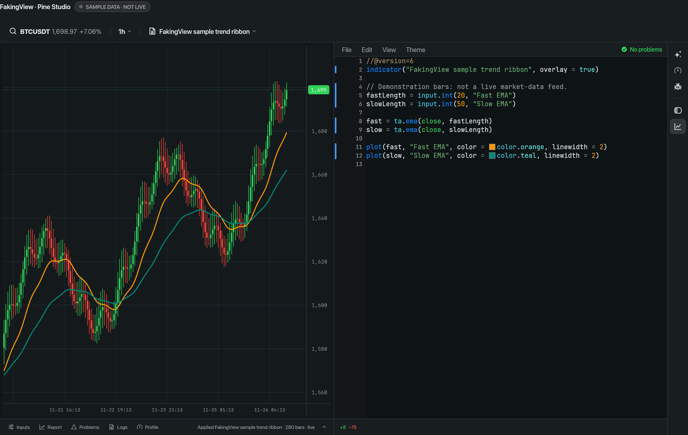

<div align="center">


# FakingView

**A native market workspace for Indian markets, charts and Pine Script.**

Connect your own Zerodha Kite Connect session. Explore price history, follow streaming quotes,
write indicators and keep your workspace on your Mac.

[](https://github.com/srg-sphynx/FakingView/releases)
[](LICENSE.md)


[Download](https://github.com/srg-sphynx/FakingView/releases) ·
[Getting started](docs/getting-started.md) ·
[App specs](docs/app-specs.md) ·
[Report an issue](https://github.com/srg-sphynx/FakingView/issues)

</div>



*The production chart renderer with deterministic sample candles and indicators. Sample data, not a live Indian market feed.*

## What you can do

| Workspace | Capabilities |
| --- | --- |
| Indian market data | Search exchange-qualified instruments; load historical OHLCV; follow WebSocket watchlist quotes with REST fallback |
| Charting | 18 chart types, 80+ drawing tools, multiple charts, overlays, saved layouts, custom timeframes and bar replay |
| Indicators | Native studies and 20 bundled Pine indicators, with a searchable catalog and live previews |
| Pine Studio | Local editor, script library, chart previews, step debugger and profiler |
| Watchlists | Multiple lists, sections, sorting, flags, price changes, sparklines and text import/export |
| Alerts | Price and Pine alerts, app notifications and optional webhooks |
| Automation | Optional local MCP server with separate read/write permissions and confirmation for sensitive actions |
| Other markets | Crypto, US equities through Alpaca, prediction markets and market-wide gauges |

FakingView is a native Rust application using egui and macOS AppKit integration. It runs locally;
there is no FakingView cloud account to create. Market-data providers and optional integrations
have their own accounts, credentials and terms.

## Start in three steps

1. Download the **macOS Apple Silicon** app from [Releases](https://github.com/srg-sphynx/FakingView/releases),
   extract it and move `FakingView.app` to Applications.
2. Open **Settings → Kite Connect**. Enter your personal API key, complete Kite's browser sign-in
   and create the daily session using the returned request token and your API secret.
3. Press **⌘K**, select Kite Connect and search `NSE:INFY`, `BSE:INFY` or `NSE:NIFTY 50`.
   Open a chart or add an instrument to a watchlist.

The [complete guide](docs/getting-started.md) covers installation, token renewal, the first chart,
watchlists, Pine Studio and troubleshooting. Kite market-data access is required; a working API
login alone does not establish historical or streaming-data entitlement.

## Built for your own Kite session



*The unconfigured connection form, rendered by the application's own UI. No account credentials are shown.*

- **Daily sign-in:** use Kite's browser login and exchange its short-lived `request_token` inside
  the app. An existing access token can also be entered directly.
- **Secure storage:** the API key and access token use macOS Keychain. The API secret and request
  token are used for the exchange and are not saved in the database or a configuration file.
- **Stable instruments:** `NSE:INFY` and `BSE:INFY` remain separate markets. The current instrument
  directory refreshes daily in Indian time so recycled derivative tokens are not saved as identity.
- **Correct time handling:** minute timestamps retain their true instant; daily bars keep the
  Indian trading date. Larger intraday bars use the app's UTC aggregation boundaries.
- **Bounded requests:** shared rate limits, page limits, response limits and typed session/rate-limit
  errors keep failures visible.

See [Kite integration details](docs/kite-connect.md) for supported exchanges, request limits,
timestamp rules and protocol references.

## Charts and scripts

Use Candles, Hollow Candles, Bars, High-Low Bars, Volume Candles, Line, Line with Markers, Step
Line, Area, HLC Area, Baseline, Columns, Heikin Ashi, Renko, Line Break, Kagi, Point & Figure or
Range. Add trend lines, Fibonacci and Gann tools, patterns, notes, measurements and other drawings.
Compare markets, save a layout or replay historical bars.



*The production Pine Studio view with a local example script and deterministic sample bars, not live market data.*

Pine Studio runs scripts locally and includes a debugger and profiler. Its Pine Script v6-style
runtime is an independent implementation with documented compatibility boundaries; it is not a
promise of identical behavior for every script. Optional AI assistance sends the requested context
to the provider you configure with your own key.

## Preview-release boundaries

The first FakingView release is **0.1.0-beta.1**, targeting **macOS 14 or newer on Apple Silicon**.
It is a preview release without an Apple Developer ID signature or notarization. The project
includes Windows, Linux and Intel macOS code and packaging, but those platforms are not claimed
as verified by this local build.

For Kite specifically:

- **Live WebSocket ticks update watchlists. Chart candles refresh through the historical REST API.**
  The app does not manufacture complete candles from a late tick subscription.
- **Kite is read-only market data.** It adds no Kite order entry. INR instruments are excluded from
  the USD portfolio and paper-trading paths.
- Indian holiday calendars, contract multipliers and exchange-specific Pine session semantics are
  not yet modeled. Pine metadata reports INR and an unknown contract kind rather than guessing.
- Daily tokens expire. A stale or closed-session quote is not evidence of an actively trading market.
- Live account authentication, data entitlement and a market-hours stream still need verification
  with your own Kite account; no account credentials are shipped.

Unsigned local bundles evaluate alerts in the foreground. Background Login Items and optional
iCloud support require separate Apple signing and entitlement setup. Automatic in-app replacement
is disabled; download a new FakingView release to update.

## Build and verify

Install Rust **1.95 or newer** and the Xcode command line tools, then:

```sh
git clone https://github.com/srg-sphynx/FakingView.git
cd FakingView
cargo test --locked
cargo clippy --locked --all-targets --all-features -- -D warnings
cargo fmt --all -- --check
./tools/bundle.sh
open target/FakingView.app
```

The release binary is `target/release/fakingview`; the Finder bundle is `target/FakingView.app`.
See [BUILDING.md](BUILDING.md) for platform and signing details and
[CONTRIBUTING.md](CONTRIBUTING.md) for the development workflow.

The release verification recorded **7,841 passing tests, no failures and 131 optional
ignored tests**, plus formatting, Clippy, visual galleries and a native launch check. These are
bounded checks, not a claim that every feature or external service is bug-free.
The [verification report](docs/verification.md) explains what was exercised.

## Documentation

- [Getting started and troubleshooting](docs/getting-started.md)
- [Application specifications](docs/app-specs.md)
- [Kite Connect implementation and limitations](docs/kite-connect.md)
- [Architecture and subsystem map](docs/architecture.md)
- [Chart types](docs/chart-types.md) · [Indicators](docs/indicator-picker.md) · [Pine debugger](docs/pine-debugger.md)
- [MCP interface](docs/mcp-implementation.md)
- [Release process](docs/releasing.md) · [Changelog](CHANGELOG.md)

Repository artwork: [GitHub social preview](assets/social/github-social-preview.png) ·
[Square social card](assets/social/social-card-square.png).

## License and independence

FakingView is an independently maintained project. It is not sponsored or endorsed by Zerodha,
TradingView or the authors of its third-party components. Product and service names identify
compatible services and remain their owners' marks.

The application is licensed under [GPL-3.0-only](LICENSE.md). Copyright notices, code provenance
and third-party acknowledgements are retained in [THIRD_PARTY_NOTICES.md](THIRD_PARTY_NOTICES.md).
Bundled fonts retain the [SIL Open Font License](docs/licensing.md).
