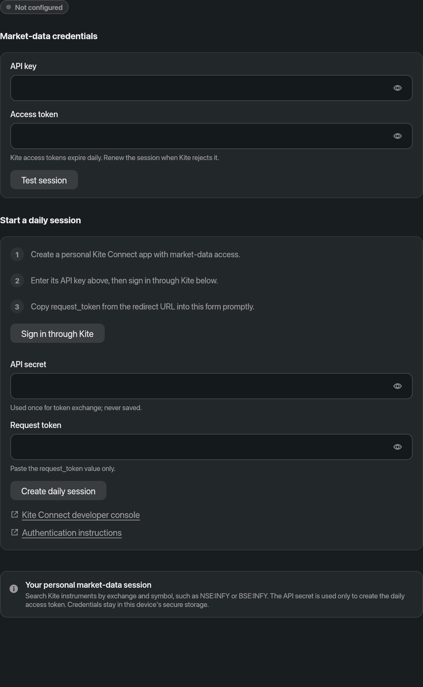
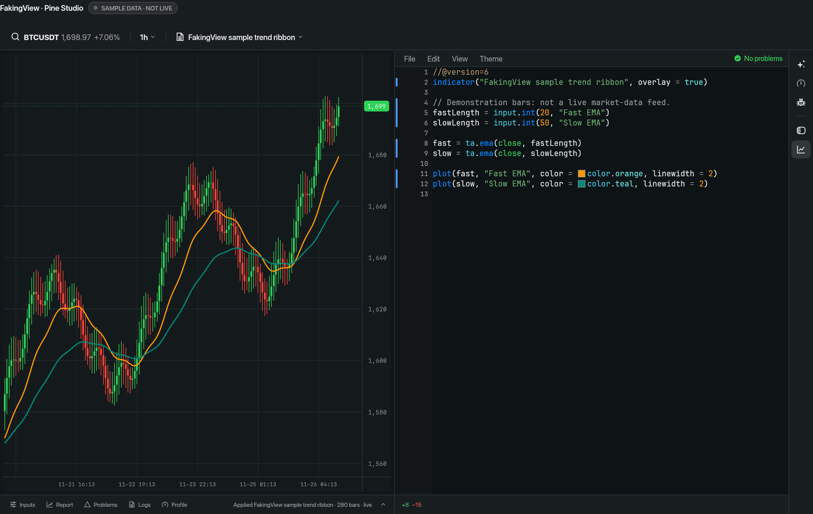

# Getting started with FakingView

This guide takes you from the macOS download to your first Kite chart and watchlist. For technical
behavior and limits, read [Kite Connect details](kite-connect.md). For hardware, packaging and
feature specifications, read [App specs](app-specs.md).

## 1. Install the app

You need an Apple Silicon Mac running macOS 14 or newer for the currently verified build.
No Rust toolchain is needed to use a downloaded `.app`.

1. Visit the [FakingView releases page](https://github.com/srg-sphynx/FakingView/releases).
2. Read the release's platform, signing status and known limitations.
3. Download the macOS arm64 archive and its published checksums. Verify the archive's SHA-256
   against the release before opening it:

   ```sh
   shasum -a 256 /path/to/the-downloaded-archive.zip
   ```

4. Extract the archive and move `FakingView.app` to your Applications folder.
5. Open the app. This preview has no Developer ID signature or notarization, so macOS can present
   a security notice. Use macOS's normal Privacy & Security review only after checking the source
   and checksum. No command to disable Gatekeeper or remove security protections is required by
   this guide.

The app opens a new-tab workspace. **⌘,** opens Settings; **⌘K** opens symbol search. The Settings
sidebar includes Kite Connect, appearance, Pine Studio, alerts, network and other integrations.

## INDmoney and Groww

1. Generate an access token in [INDstocks](https://www.indstocks.com/app/api-trading/access-tokens)
   or [Groww Cloud](https://groww.in/trade-api/api-keys). Groww requires a plan that includes
   Live Data and Backtesting. INDstocks tokens expire after 24 hours, and Groww dashboard access
   tokens expire daily at 6 AM.
2. Open **Settings → INDmoney** or **Settings → Groww** and paste the access token. Press Return
   or leave the field to save it in your device’s secure storage. Use **Test Connection** to
   verify that the account can retrieve a quote.
3. Open **⌘K → Stocks**, select the provider, and search `NSE:INFY` or `BSE:INFY`. For an explicit
   provider prefix, enter `INDMONEY:NSE:INFY` or `GROWW:NSE:INFY`. Use the same prefixes for
   watchlist import and Pine symbol IDs.

INDmoney covers NSE and BSE cash listings and currently listed NSE futures and options. Groww
covers NSE and BSE cash listings, indices, and listed futures and options. Both update historical
chart candles and poll real-time watchlist quotes over REST. Groww watchlist quotes report the
last traded price. INDmoney watchlist quotes also include previous close and volume where available.
These connections provide market data for charts, watchlists, Pine, and MCP.

[INDstocks market data documentation](https://api-docs.indstocks.com/MarketQuote/) ·
[Groww live data documentation](https://groww.in/trade-api/docs/curl/live-data) ·
[Groww historical candle documentation](https://groww.in/trade-api/docs/curl/backtesting)

## 2. Prepare Kite Connect

You need your own Zerodha account and a personal application in the
[Kite Connect developer console](https://developers.kite.trade/). The app's permissions and
subscription must permit the market-data endpoints you plan to use.

Keep the API key and API secret available privately. Configure and use the redirect URL associated
with that application in the Kite console. FakingView's current flow asks you to copy the
`request_token` returned to that redirect; it does not start a callback server or capture your
password or two-factor code.

Do not paste any real key, token, secret, account detail or redirect URL containing a token into a
GitHub issue, screenshot or chat.

## 3. Create today's session



*Application-rendered setup form with empty credential fields.*

1. Open **Settings → Kite Connect**.
2. Enter the personal application's **API key**.
3. Choose **Sign in through Kite**. Complete the login in the browser using Kite's own page.
4. After the redirect, copy only the value of the `request_token` query parameter.
5. Return to FakingView. Enter the **API secret** and **Request token**, then choose
   **Create daily session** promptly. A request token lasts only a short time and is single-use.
6. Choose **Test session** to check that Kite accepts the session.

The exchange sends Kite a checksum of the API key, request token and secret. The API secret and
request token are used transiently for that operation. The resulting API key/access-token pair
is saved in Keychain. If Keychain refuses a write, the app reports that the session is available
only for the current run; it does not silently write a plaintext fallback.

If you already obtained an access token through Kite's supported flow, enter the **API key** and
**Access token** directly. Complete credential pairs save when you leave the fields; partial edits
do not replace a working pair. There is no Save button.

A profile/session test establishes authentication. It does not prove that your account can use
historical data or WebSocket market data. Test those separately in the next steps.

## 4. Open your first Indian chart

1. Return to the chart window and press **⌘K**.
2. Select **Stocks** or **All**, then choose **Kite Connect** in the venue filter. You can also
   type an exchange-qualified query directly.
3. Try `NSE:INFY`, `BSE:INFY`, `NSE:NIFTY 50` or a company name. The current instrument directory
   determines what is listed and your account determines what data is available.
4. Select a result and press Return. Choose the timeframe, chart style and indicators from the toolbar.

NSE and BSE listings are different instruments. The exchange is part of identity, so preserve it
when importing a watchlist or referring to the same market from a script or MCP client.

Intraday charts use UTC aggregation boundaries. A 09:15 IST candle is timestamped at its actual
03:45 UTC instant; an hourly chart is consequently not anchored to 09:15 IST. Daily and longer
charts preserve the Indian trading date before calendar aggregation. These rules can differ
from the session-anchored view in another charting application.

## 5. Follow a streaming watchlist

Use the watchlist sidebar's **+** to add a market. Its symbol picker stays open so you can add
several instruments. Lists support sections, flags, sorting and import/export.

Kite watchlist prices use a shared WebSocket quote connection and fall back to REST snapshots
when appropriate. Changes are measured against the previous closing price. Price freshness
uses exchange timestamps when supplied; a recent download of an old close must not make that
trade new. Missing data stays missing.

Charts refresh through historical REST requests. A streaming watchlist quote is therefore not a
promise that the chart redraws a complete OHLC candle on every tick. No live stream is expected
while an exchange is closed, and the app does not supply an Indian holiday calendar.

Supported text forms include:

```text
###Indian equities
NSE:INFY
BSE:INFY
###Indices
NSE:NIFTY 50
```

An exported FakingView list can also include the provider-qualified form `KITE:NSE:INFY`.

## 6. Work in Pine Studio



*Pine Studio rendered with deterministic sample bars and an example script. This is not a live feed.*

Open Pine Studio from the workspace. Pick an existing script or create one, choose a preview
instrument, and run it locally. Kite instruments are available in its stock-market selector when
the session is configured. The editor includes diagnostic messages, a step debugger and profiler.

A Kite ticker ID has the form `KITE:NSE:INFY`. Chart scripts and alert subscriptions report INR;
instrument kind remains `unknown` because the provider includes shares, indices, options, futures
and currency instruments. Contract metadata, exchange-specific sessions and currency conversion
need separate validation before using a script's strategy-sizing or session-dependent results.

The runtime supports Pine Script v6-style workflows with its own documented compatibility limits.
See [the Pine architecture](architecture/pine.md), [debugger](pine-debugger.md) and
[profiler](pine-profiler.md) before relying on behavior that is specific to another implementation.

## Renew, disconnect and update

Kite access tokens expire daily and may be invalidated earlier by logout or revocation. When
FakingView asks you to renew the session, repeat browser login and token exchange. A failed or lost
one-use exchange response can require a new request token; repeatedly submitting the old one is
not a renewal mechanism. Reopen **⌘K** after setup so the search uses the new session.

**Remove credentials** removes the saved pair from FakingView's secure store. It is local removal,
not a request to revoke a token at Kite. Developers using environment credentials must also clear
those variables to stop that fallback.

For an app update, quit FakingView and replace the app with the next release from this repository.
The application stores its data separately, but back up important scripts and workspaces before
an update. Automatic in-app replacement is disabled.

## Troubleshooting

| Symptom | Check |
| --- | --- |
| “Add your Kite Connect API key and access token” | Finish both fields or complete the daily token exchange; a lone API key is not a session |
| Session expired or refused | Sign in through Kite again and use a fresh request token; check that the key/secret belong to the same developer app |
| Session test passes but charts fail | Check historical-data entitlement and instrument availability; profile access and market-data access are separate |
| Empty symbol results | Select Kite Connect, use the exchange-qualified symbol and check the current instrument directory; expired contracts may no longer be listed |
| Rate-limit error | Allow the app's backoff to complete; avoid opening many deep-history requests at once |
| Fewer candles than requested | Historical requests are bounded at 30,000 base candles and 20 pages; large folded intervals can return fewer displayed bars |
| A quote is stale | Check exchange hours, the quote timestamp, network and session validity; an old close is not replaced with a fabricated new trade |
| A market is unavailable in paper trading or portfolios | INR settlement and contract specifications are not implemented in those account paths; Kite is market data only |
| API credentials disappear after quit | Check whether Keychain refused storage; the app reports a session-only connection when it cannot persist |
| Background alerts do not run after quit | The unsigned preview uses foreground evaluation; background Login Items need the documented Apple signing setup |

If you need help, [open an issue](https://github.com/srg-sphynx/FakingView/issues) with the app version,
macOS version, architecture, provider, timeframe, exact error and reproduction steps. Mask account
identifiers and remove secrets from logs and images. Do not submit a database containing your
personal workspace unless a maintainer explains a safe, minimal reproduction method.

## Data and optional integrations

The macOS data directory is `~/Library/Application Support/local.fakingview.desktop/`; the SQLite
file is `fakingview.sqlite`. Regenerable network cache data is under
`~/Library/Caches/local.fakingview.desktop/`. Credentials use the platform secure store rather
than either directory.

Kite, other market providers, optional AI providers, snapshot hosts and webhook destinations are
external services. Their requests are separate from local chart rendering and storage. Enable
only the integrations you intend to use. The MCP server is off by default and has its own
permissions and credentials; see [MCP documentation](mcp-implementation.md).
